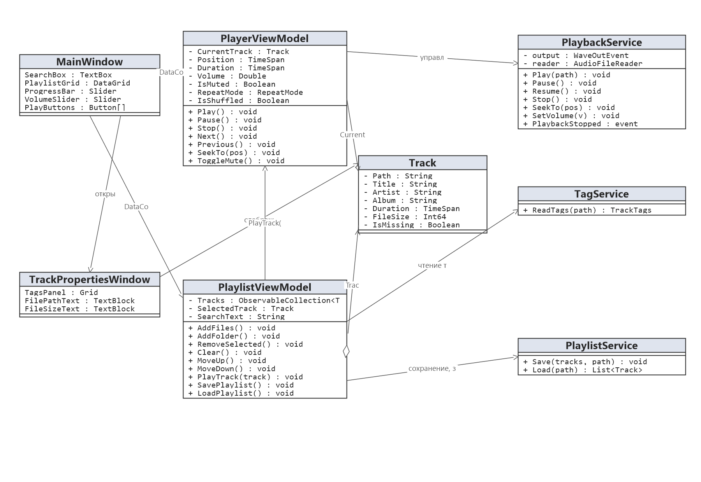
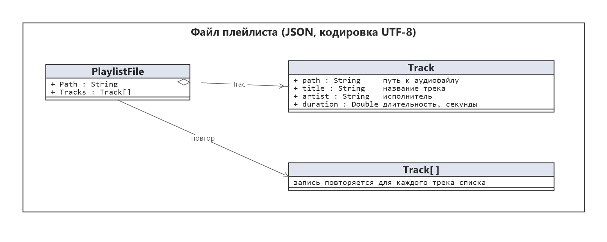
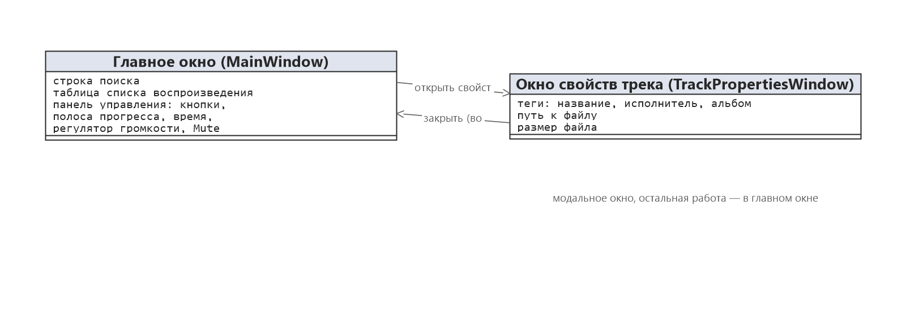

# Проектная документация — Requiem

Структура — ГОСТ 19.404-79, правила оформления — ГОСТ 2.105-95.
Сдаваемая версия оформлена в DOCX; настоящий файл — версия для репозитория.
Разработка ведётся на основании [ТЗ.txt](ТЗ.txt).

## 1. Введение

Тема разработки — «Разработка аудиоплеера MP3/WAV на платформе WPF (C#)», наименование программы — «Requiem». Разработка ведётся на основании технического задания, утверждённого «___» ______________ 20___ г. Настоящая проектная документация определяет архитектуру приложения, состав классов, структуру хранимых данных и схему навигации экранов.

## 2. Назначение и область применения

Приложение предназначено для локального воспроизведения аудиофайлов форматов MP3 и WAV: ведение списка воспроизведения с сохранением и загрузкой, управление воспроизведением (запуск, пауза, остановка, перемотка, громкость), чтение тегов ID3, поиск по списку. Область применения — персональный компьютер под управлением Windows 10 или Windows 11; работа полностью автономная, без подключения к сети; число пользователей — один.

## 3. Технические характеристики

### 3.1 Архитектура приложения

Приложение построено по архитектуре MVVM. Слой Model содержит сущность `Track` (путь, название, исполнитель, альбом, длительность, размер файла, признак отсутствия файла). Слой ViewModel включает две вью-модели: `PlayerViewModel` — состояние воспроизведения (текущий трек, позиция, громкость, режимы повтора и перемешивания) и `PlaylistViewModel` — список треков, выбранный трек и фильтр поиска. Слой View содержит главное окно `MainWindow` (строка поиска, таблица списка, панель управления) и окно свойств трека `TrackPropertiesWindow`. Слой Services выделяет обращения к внешним библиотекам: `PlaybackService` (вывод звука через NAudio, событие `PlaybackStopped`), `TagService` (чтение тегов через TagLib#), `PlaylistService` (сохранение и загрузка списков через System.Text.Json).

View не обращается к сервисам напрямую: взаимодействие выполняется через команды и привязки данных вью-моделей. Сервисы скрывают детали используемых библиотек от вью-моделей. Автопереход к следующему треку реализован подпиской `PlayerViewModel` на событие `PlaybackStopped` сервиса `PlaybackService`.

### 3.2 Диаграмма классов

Состав классов приложения и связи между ними приведены на рисунке 1.

*Рисунок 1 — Диаграмма классов*

`PlayerViewModel` управляет сервисом `PlaybackService` и хранит ссылку на текущий трек. `PlaylistViewModel` агрегирует коллекцию треков, читает теги через `TagService`, сохраняет и загружает список через `PlaylistService` и передаёт выбранный трек к воспроизведению в `PlayerViewModel`. Окно `TrackPropertiesWindow` отображает поля выбранного трека.

### 3.3 Структура данных

База данных в приложении не используется: единственное постоянное хранение — файлы плейлиста формата JSON (кодировка UTF-8). Структура файла приведена на рисунке 2, назначение полей записи — в таблице 1.

*Рисунок 2 — Структура файла плейлиста*

Таблица 1 — Поля записи трека в файле плейлиста:

| Поле | Тип | Назначение |
|------|-----|------------|
| path | String | путь к аудиофайлу |
| title | String | название трека |
| artist | String | исполнитель |
| duration | Double | длительность трека, секунды |

При загрузке плейлиста файлы, отсутствующие по указанному пути, помечаются признаком `IsMissing` и отображаются в таблице серым цветом (раздел 4.2 технического задания).

### 3.4 Схема навигации экранов

Приложение содержит два экрана. Главное окно — единственная точка входа: строка поиска, список воспроизведения и панель управления размещены в нём. Окно свойств трека открывается из главного окна по выбранному треку и закрывается возвратом в главное окно; остальная навигация выполняется внутри главного окна без смены экрана. Схема навигации приведена на рисунке 3.

*Рисунок 3 — Схема навигации экранов*

### 3.5 Структура проекта

Проект организован по папкам: `Models` (сущность `Track`, пространство имён `Requiem.Models`), `ViewModels` (`PlayerViewModel` и `PlaylistViewModel`, `Requiem.ViewModels`), `Views` (`MainWindow` и `TrackPropertiesWindow`, `Requiem.Views`), `Services` (`PlaybackService`, `TagService`, `PlaylistService`, `Requiem.Services`).

## 4. Результаты проверки

Проверке подлежат контрольные сценарии, определённые разделом 8 технического задания:

1) открытие трёх аудиофайлов и запуск второго трека двойным кликом;
2) многократные нажатия кнопок паузы, остановки и запуска в произвольном порядке;
3) перемотка к концу текущего трека и автопереход к следующему;
4) установка громкости в ноль и включение Mute;
5) сохранение списка, перезапуск программы и загрузка списка;
6) добавление папки с вложенными подпапками;
7) воспроизведение повреждённого файла и переход к следующему треку;
8) воспроизведение трека с русским названием и пробелами в пути.

На момент выпуска настоящей документации приложение находится в разработке; результаты проверки каждого сценария и перечень выявленных ограничений будут внесены в настоящий раздел по завершении реализации. Известные ограничения определены разделом 6 технического задания: отсутствуют стриминг и интернет-радио, воспроизведение видеофайлов, эквалайзер, скины и темы оформления, редактирование тегов, перемещение треков перетаскиванием, визуализация, горячие клавиши и мини-режим.

## 5. Источники, использованные при разработке

Документация Microsoft Learn по WPF и .NET 8; библиотека NAudio версии 2.2.1; библиотека TagLib# версии 2.3.0; библиотека System.Text.Json из состава .NET 8.
